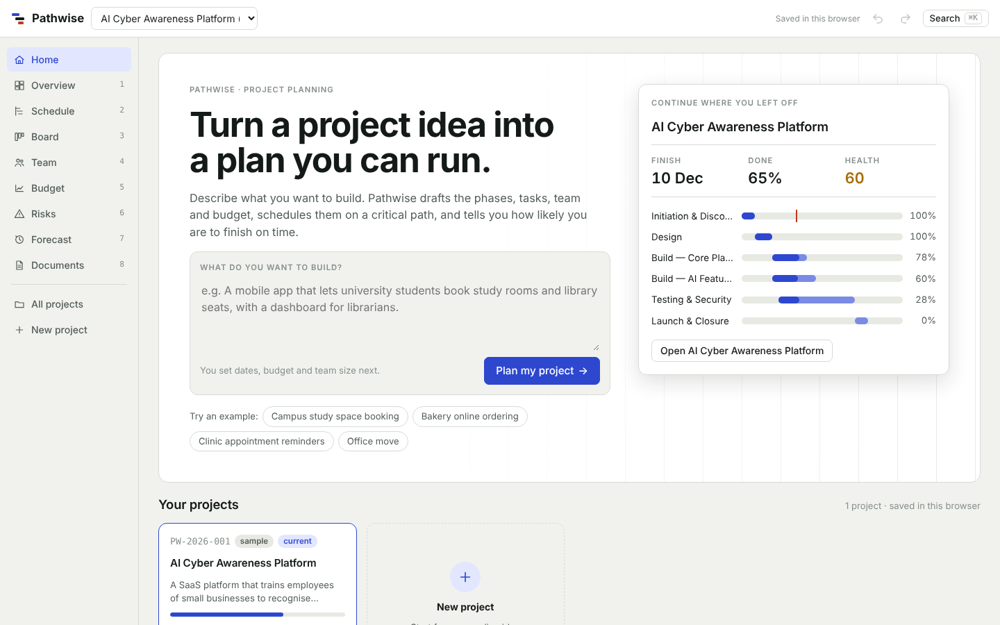
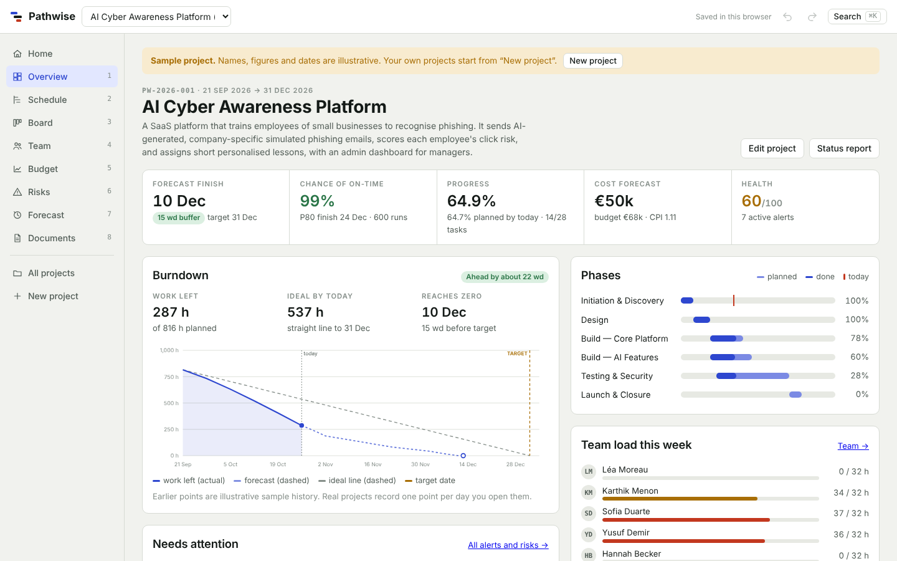
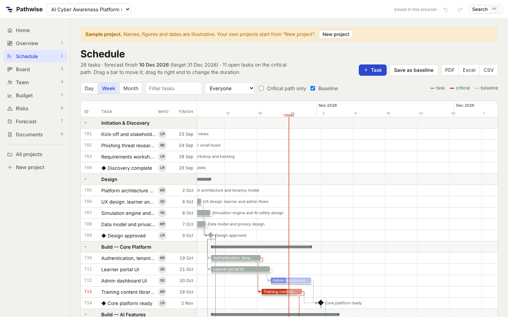
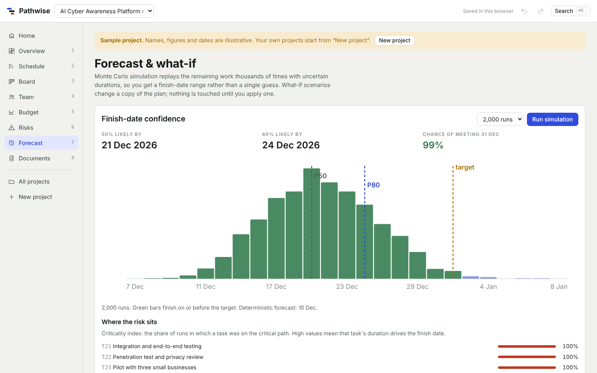

# Pathwise

**Turn a project idea into a plan you can run.**

Pathwise is a project-planning dashboard. You describe what you want to build in a sentence or two, and it produces a full plan: phases and tasks with dependencies, a critical-path schedule, team workload, an earned-value budget, a risk register, a burndown chart and a finish-date forecast. Every view is connected, so changing one task updates the schedule, budget, warnings and documents at once.

**Live demo:** https://pathwise-mai5.netlify.app



## Features

| Area | What it does |
| --- | --- |
| Home | Start a project from a one-line idea, try example ideas, and open existing projects |
| Overview | Forecast finish, chance of finishing on time, progress, cost forecast, health score, burndown and alerts |
| Schedule | Gantt chart on the critical path with dependency arrows, baseline bars and drag-to-reschedule |
| Board | Kanban board by status, plus a burndown of work left against the ideal line |
| Team | Weekly workload heatmap per person with rebalancing suggestions |
| Budget | Earned value (PV, EV, AC, CPI, SPI, EAC), S-curve, budget by category and expenses |
| Risks | Automatic early warnings, a 5×5 risk matrix and an editable risk register |
| Forecast | Monte Carlo simulation (1,000 to 5,000 runs) and what-if scenarios compared with the live plan |
| Documents | Seven documents (charter, WBS, schedule, budget report, risk register, RACI, weekly status) as Word, PDF or Markdown |
| Downloads | Gantt chart PDF, Excel workbook, tasks CSV, project backup (.json) and a ZIP of everything |







## How to use it

1. Open the live demo. A sample project, *AI Cyber Awareness Platform*, is loaded so you can explore every view.
2. On **Home**, type an idea or click an example such as *Campus study space booking*, then click **Plan my project**.
3. Set the start date, target date, budget and team size, and create the plan.
4. Move tasks on the **Schedule** or **Board**, record expenses on **Budget**, and run the simulation on **Forecast**.
5. Download documents from **Documents**.

Keyboard shortcuts: `1` to `8` switch views, `Ctrl+K` opens search, `Ctrl+Z` undoes a change.

## How it works

- **Scheduling engine:** critical path method on working days, with finish-to-start dependencies, lags and start-no-earlier-than dates. Tasks running late push their successors.
- **Simulation:** each open task has optimistic, likely and pessimistic durations (triangular distribution). The simulation reports P50 and P80 finish dates, the chance of meeting the target, and each task's criticality index.
- **Earned value:** labour cost is effort × hourly rate, plus non-labour budget lines; EAC = AC + (BAC − EV) / CPI.
- **Burndown:** remaining planned effort in hours, compared with a straight ideal line to the target date, with a forecast curve from the current schedule.
- **File exports:** Word and Excel files are written as Office Open XML and zipped with [JSZip](https://stuk.github.io/jszip/); PDFs are drawn with [pdf-lib](https://pdf-lib.js.org/). Both libraries load from a CDN the first time you download a file. Everything is generated in the browser.
- **Storage:** projects are saved in the browser's local storage. Use **Back up project** to move a project between browsers or devices.

The whole app is a single file, `index.html`, with no build step.

## Run it locally

Open `index.html` in a browser, or serve the folder:

```bash
python3 -m http.server 8000
# then open http://localhost:8000
```

## Deploy

**GitHub Pages:** in the repository, go to **Settings → Pages**, set **Source** to *Deploy from a branch*, choose `main` and `/ (root)`, and save. The site appears at `https://<your-username>.github.io/<repository-name>/`.

**Netlify:** drag the folder (or a zip of it) onto the Deploys page of a Netlify site. `netlify.toml` adds basic security headers.

## Project structure

```
index.html            The complete app: markup, styles and script
netlify.toml          Netlify settings
.nojekyll             Tells GitHub Pages to serve files as they are
docs/screenshots/     Images used in this README
```
